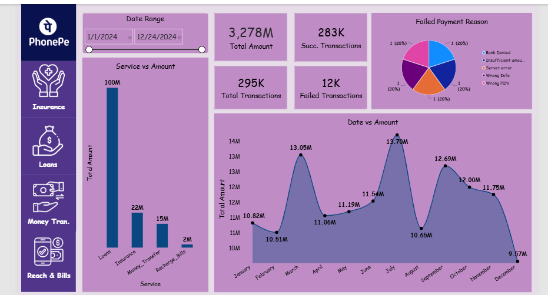
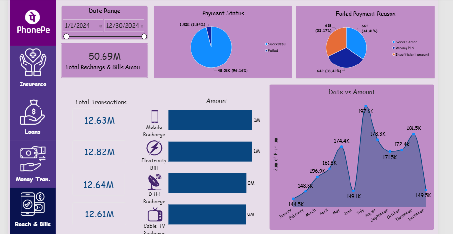
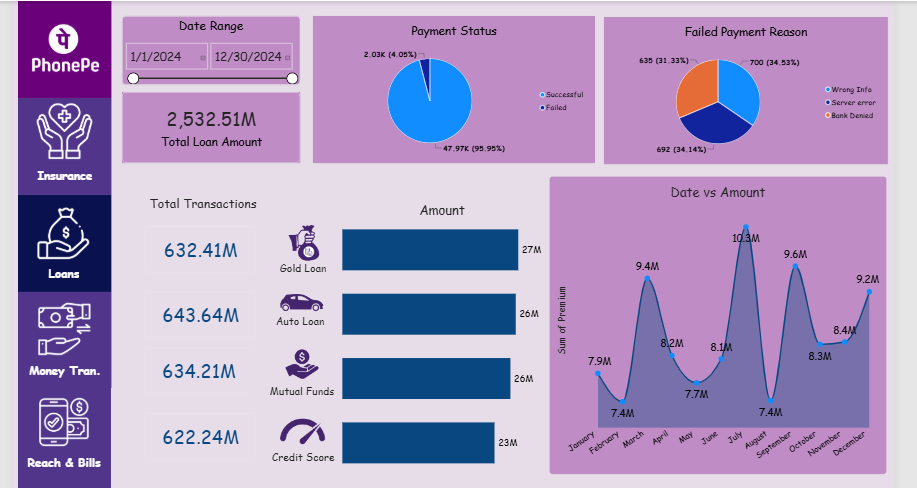
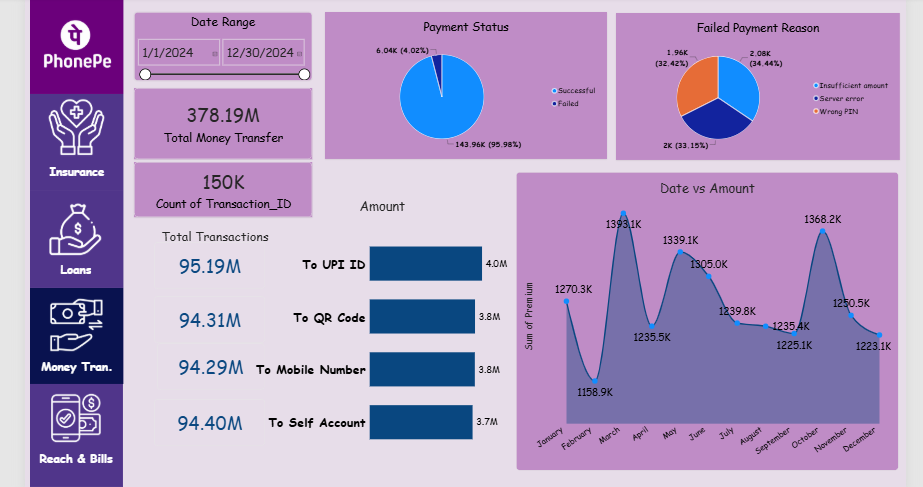
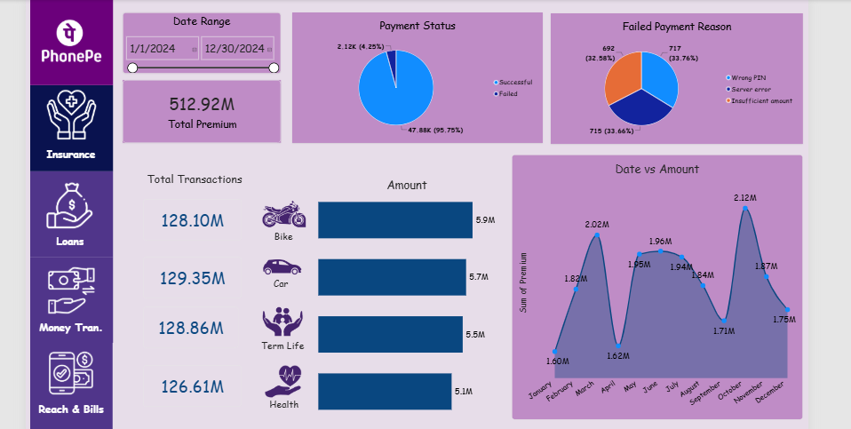

<div align="center">

# PhonePe Payment Failure Diagnostics & Financial Services Analytics

**End-to-end SQL analysis and interactive Power BI reporting**

Explore payment success, diagnose transaction failures, and understand service-level trends across digital financial services.

<br>

[](https://app.powerbi.com/links/8hC97_aEAY?ctid=48098289-8fc6-44d8-93e9-b50e5cadd058%26pbi_source=linkShare)
[](#sql-analysis)
[](https://github.com/pradipta2005/payment-failure-diagnostics)

</div>

---

## Table of Contents

- [Project Overview](#project-overview)
- [Live Dashboard](#live-dashboard)
- [Dashboard Preview](#dashboard-preview)
  - [Overall Dashboard](#1-overall-dashboard)
  - [Recharge & Bills](#2-recharge--bills)
  - [Loans](#3-loans)
  - [Money Transfers](#4-money-transfers)
  - [Insurance](#5-insurance)
- [Project Objectives](#project-objectives)
- [SQL Analysis](#sql-analysis)
- [Business Questions](#business-questions)
- [Key Dashboard Elements](#key-dashboard-elements)
- [Technology Stack](#technology-stack)
- [Repository Structure](#repository-structure)
- [Getting Started](#getting-started)
- [Project Deliverables](#project-deliverables)
- [Future Improvements](#future-improvements)
- [About the Author](#about-the-author)

---

## Project Overview

Digital payment platforms process transactions across multiple services and customer journeys. Monitoring transaction outcomes, understanding why payments fail, and identifying changes in customer activity are important for improving payment reliability and business performance.

**Payment Failure Diagnostics** is a data analytics portfolio project that uses SQL and Microsoft Power BI to examine a PhonePe-style financial services dataset. It combines SQL scripts for data preparation and business analysis with an interactive dashboard for exploring transaction performance and trends.

The analysis covers four service areas:

- **Recharge & Bills**
- **Insurance**
- **Loans**
- **Money Transfers**

The project focuses on turning transaction-level data into useful operational and customer-oriented insights through structured queries, KPIs, and visual reporting.

> **Disclaimer:** This is an independent portfolio project created for educational and analytical purposes. It is not affiliated with, sponsored by, or endorsed by PhonePe. The analysis and dashboard reflect the dataset available in this repository.

## Live Dashboard

<div align="center">

### Explore the interactive Power BI report

[](https://app.powerbi.com/links/8hC97_aEAY?ctid=48098289-8fc6-44d8-93e9-b50e5cadd058%26pbi_source=linkShare)

</div>

The published report provides interactive filtering and service-specific views. Open it in Power BI to explore the available date range, transaction metrics, payment status, failure reasons, and monthly trends.

## Dashboard Preview

### 1. Overall Dashboard

The overview brings together service-level comparisons and transaction amount trends.



### 2. Recharge & Bills

Explore recharge and bill payment activity, payment outcomes, failure reasons, and monthly premium/amount trends.



### 3. Loans

Review loan-related transaction activity, payment status, failure-reason distribution, and monthly amount trends.



### 4. Money Transfers

Explore money transfer activity across transaction destinations, payment outcomes, failure reasons, and monthly trends.



### 5. Insurance

Analyze insurance-related transaction activity, payment status, failure reasons, and monthly premium trends.



## Project Objectives

- Clean and prepare transaction data for analysis.
- Calculate and examine payment success and failure performance.
- Diagnose the distribution of recorded payment failure reasons.
- Compare transaction activity and amounts across service categories.
- Analyze monthly trends in transaction amounts.
- Explore customer/category retention patterns.
- Identify potential churn-risk signals.
- Examine cross-sell opportunities across financial services.
- Communicate analytical results through an interactive Power BI dashboard.

## SQL Analysis

The `Sql Analytics/` directory contains six SQL scripts organized around the project's analytical workflow.

| File | Analysis |
|---|---|
| `01_data_cleaning.sql` | Data cleaning and preparation |
| `02_payment_success_rate.sql` | Payment success-rate analysis |
| `03_root_cause_diagnostics.sql` | Root-cause diagnostics for payment failures |
| `04_A_category_retention_analysis.sql` | Category retention analysis |
| `04_B_churn_risk_identification.sql` | Churn-risk identification |
| `05_cross_sell_analysis.sql` | Cross-sell opportunity analysis |

The sequence starts with data preparation, moves into payment performance and failure diagnostics, and then explores customer-oriented analysis.

## Business Questions

This project is designed to investigate questions such as:

1. What is the distribution of successful and failed transactions?
2. Which recorded reasons contribute to payment failures?
3. How do transaction counts and amounts vary across service categories?
4. How do transaction amounts change over the months?
5. What retention patterns can be observed across service categories?
6. Which customer or category behaviours may indicate churn risk?
7. Which service combinations may present cross-sell opportunities?

## Key Dashboard Elements

Depending on the selected service view and report filters, the dashboards include:

- Date-range filtering
- Transaction and amount KPIs
- Successful vs. failed payment breakdown
- Failed payment reason distribution
- Service/category amount comparisons
- Monthly amount trend visualizations

## Technology Stack

| Technology | Usage |
|---|---|
| **SQL** | Data preparation, querying, aggregation, and diagnostic analysis |
| **Microsoft Power BI** | KPI reporting, interactive filters, and data visualization |
| **Git & GitHub** | Version control, source-code hosting, and project documentation |

## Repository Structure

```text
payment-failure-diagnostics/
│
├── assets/
│   ├── bills.png
│   ├── home.png
│   ├── insurance.png
│   ├── loans.png
│   └── money_transfer.png
│
├── datasets/
│   └── (project dataset files)
│
├── Sql Analytics/
│   ├── 01_data_cleaning.sql
│   ├── 02_payment_success_rate.sql
│   ├── 03_root_cause_diagnostics.sql
│   ├── 04_A_category_retention_analysis.sql
│   ├── 04_B_churn_risk_identification.sql
│   └── 05_cross_sell_analysis.sql
│
├── LICENSE
├── PhonePay_Dashboard.pbix
└── README.md
```

## Getting Started

### 1. Clone the repository

```bash
git clone https://github.com/pradipta2005/payment-failure-diagnostics.git
cd payment-failure-diagnostics
```

### 2. Review the dataset

Explore the files in the `datasets/` directory. Review the available columns, data types, and table structure before running the SQL scripts.

### 3. Run the SQL analysis

- Open the scripts in `Sql Analytics/`.
- Identify the database dialect and source table references used by the scripts.
- Load the dataset into a compatible SQL environment.
- Execute the scripts in sequence, beginning with `01_data_cleaning.sql`.
- Adjust table or column references only if your local schema differs from the one expected by the scripts.

### 4. Open the Power BI report

Open `PhonePay_Dashboard.pbix` using **Microsoft Power BI Desktop**.

If Power BI requests a data source, configure it to point to the dataset location in your environment and refresh the report.

### 5. Explore the published report

You can also use the published dashboard directly:

[Open the live Power BI dashboard](https://app.powerbi.com/links/8hC97_aEAY?ctid=48098289-8fc6-44d8-93e9-b50e5cadd058%26pbi_source=linkShare)

> **Reproducibility note:** The exact database engine, dataset schema, and data-loading instructions should be confirmed from the SQL files and dataset. Configure your environment accordingly before executing the scripts.

## Project Deliverables

| Deliverable | Repository location |
|---|---|
| SQL analysis scripts | `Sql Analytics/` |
| Dataset files | `datasets/` |
| Dashboard source file | `PhonePay_Dashboard.pbix` |
| Dashboard screenshots | `assets/` |
| Published interactive dashboard | [Power BI report](https://app.powerbi.com/links/8hC97_aEAY?ctid=48098289-8fc6-44d8-93e9-b50e5cadd058%26pbi_source=linkShare) |

## Future Improvements

- Add a data dictionary describing each dataset and its fields.
- Document the SQL database engine, schema, and setup process.
- Add a concise findings report with validated business insights.
- Include additional failure analysis by payment method, bank, device, geography, or time where the required fields are available.
- Add automated data-quality checks and reusable SQL views.
- Document dashboard refresh and publication steps.

## About the Author

**Pradipta Khan**  
Data Analytics | SQL | Power BI

- **GitHub:** [@pradipta2005](https://github.com/pradipta2005)

---

<div align="center">

If you find this project interesting, consider giving the repository a ⭐.

**From transaction data to actionable analytics.**

</div>
